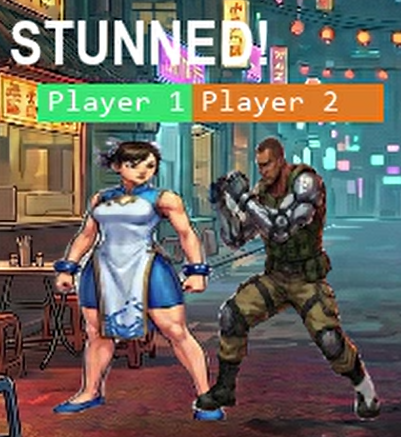
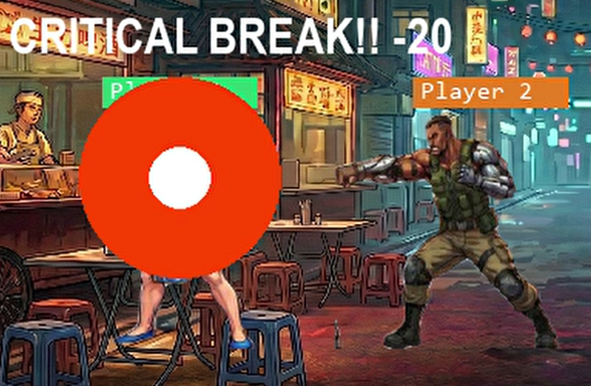
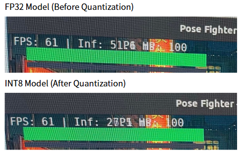

# Pose Fighter

部署於 **NVIDIA Jetson Xavier NX** 的雙人體感格鬥遊戲。透過攝影機與 **Ultralytics YOLOv8n Pose** 辨識玩家姿態，將出拳、防禦與身體傾斜轉換為遊戲操作，以 Pygame 呈現對戰畫面，並使用 TensorRT 執行模型推論。


一般攻擊命中會造成 10 點傷害，畫面顯示 `HIT!! -10`，並呈現擊中特效與血條變化。

## 玩家動作與防禦回饋


左側玩家向對手出拳，右側玩家舉起雙手防禦。這組玩家動作對應下方的防守成功畫面：右側 2P 擋下攻擊後，左側攻擊者 1P 進入暈眩，頭上出現 `STUNNED!` 提示。



防禦成功時，防守者不扣血，攻擊者的出拳會被取消，並短暫無法移動與攻擊。暈眩計時設定為 30 個遊戲更新影格。

骨架辨識圖片為展示紀錄；目前 `main.py` 執行時顯示遊戲視窗，不另外開啟骨架預覽視窗。

## 操作方式

兩位玩家分別站在攝影機鏡像畫面的左右兩側，讓肩膀、手腕與髖部保持在可辨識範圍內。

| 操作 | 玩家動作 | 遊戲行為 |
| --- | --- | --- |
| 玩家分配 | 站在鏡像畫面左半／右半 | 分別控制 1P／2P |
| 攻擊 | 朝對手方向伸出手臂，再收回 | 在收拳瞬間觸發一次攻擊；須在攻擊範圍內才會命中 |
| 防禦 | 雙手手腕抬高至肩膀附近或以上 | 優先判定為防禦，成功擋下攻擊會使攻擊者暈眩 |
| 前進／後退 | 上半身朝對手方向／反方向傾斜 | 依肩膀相對髖部的偏移控制角色移動 |
| 結束遊戲 | 關閉遊戲視窗 | 離開程式 |

每位玩家初始血量為 100。一般命中會累積能量，連擊達到第三擊時另有能量獎勵；能量達 5 格後，下一次有效命中會消耗能量，造成 20 點暴擊傷害與較大的擊退。遊戲包含連擊提示、命中停頓、畫面震動、緩衝血條與暴擊撞牆反彈。

啟動後自動倒數開戰；一方血量歸零後顯示勝者，稍後重置並開始下一回合。

### 暴擊傷害



能量蓄滿後的有效命中會顯示 `CRITICAL BREAK!! -20`。上圖為 2P 擊中 1P，搭配較大的紅色命中特效與擊退；若將對手擊退至牆角，還會觸發反彈與暈眩。

## 系統架構

```text
攝影機影像
    │
    ▼
背景執行緒：YOLOv8 Pose / TensorRT → 關鍵點 → 動作判斷
    │
    ▼
Queue（只保留最新一筆結果）
    │
    ▼
主執行緒：Pygame → 移動與攻擊判定 → 血量、特效與畫面更新
```

- 辨識與遊戲畫面使用不同執行緒，主迴圈以 60 FPS 為更新目標。
- 以畫面中線分配玩家，兩人應留在各自的半邊，避免交換控制角色。
- 攻擊採收拳觸發，持續伸直手臂不會連續出拳；出拳姿態維持 15 個影格，減少動作閃爍。
- 未偵測到玩家時，角色仍保留在遊戲畫面，移動與防禦回到待機狀態。

## 執行環境

| 項目 | 設定 |
| --- | --- |
| 部署裝置 | NVIDIA Jetson Xavier NX |
| Docker 基底 | `nvcr.io/nvidia/l4t-pytorch:r35.2.1-pth2.0-py3` |
| 姿態辨識 | Ultralytics YOLOv8n Pose，`v8.2.100` |
| 推論引擎 | `game/yolov8n-pose.engine` |
| 遊戲與影像處理 | Python、Pygame、OpenCV、NumPy |
| 攝影機 | 啟動腳本預設使用 USB 攝影機 `/dev/video0` |
| 影像／遊戲視窗 | 攝影機設定 640 × 480；遊戲視窗 800 × 400 |
| 顯示環境 | Jetson 本機圖形桌面，透過 X11 顯示容器視窗 |

主機需已安裝 Docker 與 NVIDIA Container Runtime。主機實際使用的 JetPack、CUDA、TensorRT 完整版本尚未另行記錄；Docker 基底版本不等同於主機版本的驗證紀錄。

## 建置與啟動

下載儲存庫後，在 Jetson Xavier NX 的本機圖形桌面開啟終端機，從專案根目錄執行：

```bash
cd game
sudo docker build -t pose-fighter:v1 .
bash run.sh
```

`run.sh` 會把目前目錄掛載到容器的 `/app`，提供 NVIDIA Runtime、X11 顯示與 `/dev/video0` 攝影機存取。請在 `game/` 內建置與啟動，模型與遊戲素材也放在此目錄，以相對路徑讀取。

### 套件與依賴

專案以 Dockerfile 管理安裝流程，不另設 `requirements.txt`。Jetson 的 GPU 套件與 OpenCV 需配合平台環境，不能只靠一般的 pip 套件清單建立完整環境。

| 依賴 | 用途與安裝來源 |
| --- | --- |
| Python、PyTorch／TorchVision | 使用 L4T PyTorch 基底環境；PyTorch 需為相容 Jetson CUDA 的版本 |
| TensorRT | 載入 `.engine` 模型，需確認容器與主機 JetPack 環境相容 |
| Ultralytics `8.2.100` | Dockerfile 從指定版本原始碼安裝，用於 YOLOv8 Pose 推論 |
| NumPy | 主程式直接使用，亦為 Ultralytics 的依賴，安裝後需確認可用 |
| OpenCV（`cv2`） | 讀取攝影機；沿用 Jetson 環境的版本，不另外安裝 `opencv-python`，CSI 管線另需 GStreamer 支援 |
| Pygame | Dockerfile 直接透過 pip 安裝，用於遊戲視窗、事件與繪圖 |
| SDL2、字型與圖形函式庫 | Dockerfile 透過 apt 安裝，提供 Pygame 與視窗顯示所需的底層支援 |

`threading`、`queue`、`random` 與 `time` 為 Python 標準函式庫，不需要另外安裝。INT8 實驗用的 PyCUDA 不屬於主遊戲的執行依賴。

### 模型與攝影機注意事項

`main.py` 是遊戲入口，程式透過以下設定載入姿態辨識引擎。

```python
MODEL_PATH = 'yolov8n-pose.engine'
model = YOLO(MODEL_PATH)
```

| 模型檔案 | 格式與用途 |
| --- | --- |
| `yolov8n-pose.onnx` | ONNX（Open Neural Network Exchange）模型，保存模型結構與權重，可供相容推論工具讀取，也可交由 TensorRT 建置引擎 |
| `yolov8n-pose.engine` | TensorRT 建置後的推論引擎，針對目標 GPU 與環境最佳化，供目前的遊戲程式載入 |

一般使用流程為 ONNX 模型 → TensorRT 建置 → `.engine` 引擎 → `main.py` 載入並處理攝影機影像。遊戲啟動方式請依上方 Docker 指令操作。模型格式與引擎建置可參閱 [ONNX 文件](https://onnx.ai/onnx/intro/concepts.html)及 [NVIDIA TensorRT 文件](https://docs.nvidia.com/deeplearning/tensorrt/latest/inference-library/python-api-docs.html)。

- 儲存庫附上遊戲使用的 `yolov8n-pose.engine` 與同名 ONNX 模型。TensorRT 引擎受 GPU 與軟體版本限制，不保證可直接用於其他裝置；不相容時需在目標環境重新建置引擎，目前未提供自動重建腳本。
- 引擎中繼資料記錄任務為 `pose`、模型輸入為 640 × 640、共 17 個人體關鍵點，Ultralytics 版本為 `8.2.100`，未標示 FP32／FP16／INT8 精度。
- 程式有 CSI 攝影機的 GStreamer 備援管線，但目前 `run.sh` 僅設定 USB 攝影機存取，未提供完整 CSI 容器啟動設定。
- 若出現找不到模型或圖片的錯誤，先確認工作目錄；若無法開啟視窗或攝影機，確認 `DISPLAY` 與 `/dev/video0` 是否可用。

## 量化實驗紀錄



這張圖片保留當時標示為 FP32 與 INT8 的實驗畫面，兩者遊戲更新率皆顯示約 61 FPS。`FPS` 為 Pygame 畫面更新率；`Inf` 為一次模型呼叫的耗時，包含前處理與後處理，不能將兩者視為同一項效能指標。

圖中的耗時數字與 HP 文字有重疊，因此不據此列出精確加速比例。原始校準圖片與完整量測資料未保留，量化腳本以參考工具公開，不宣稱可重現當時的量化結果。目前附帶引擎的精度無法僅憑檔名或中繼資料確認。

### INT8 校準參考腳本

`scripts/build_int8_engine.py` 展示以 TensorRT Entropy Calibrator 進行 INT8 校準與建置引擎的流程，供量化實驗參考。[校準腳本](scripts/build_int8_engine.py)

執行前需自行準備：

- **ONNX 模型**：預設讀取工作目錄中的 `best.onnx`。請依使用的模型調整腳本末尾的輸入路徑。
- **校準圖片**：放入工作目錄的 `calib_images/`，目前接受副檔名為 `.jpg` 或 `.png` 的檔案。建議收集接近部署場景的人體照片，涵蓋玩家姿勢、距離、背景與光線變化。
- **校準環境**：需有相容的 TensorRT、PyCUDA、OpenCV 與 NumPy。遊戲 Dockerfile 未額外安裝 PyCUDA，執行此工具前需另行準備。

預設使用每批 4 張圖片、640 × 640 輸入，至少需有一個完整批次。校準器將圖片直接縮放、轉 RGB／CHW 並除以 255；批次大小、輸入形狀及前處理需與 ONNX 模型相符，請確認後再執行。腳本保留原始實驗實作，尚未針對任意 ONNX 模型或 TensorRT 版本驗證。

若沿用預設路徑，先在 `scripts/` 放好 `best.onnx` 與 `calib_images/`，再從專案根目錄執行：

```bash
cd scripts
python3 build_int8_engine.py
```

輸出為 `yolo_int8.engine` 與 `yolo_calib.cache`。這些輸出與自行收集的校準資料已加入 Git 排除規則。改用新的圖片可以重新進行校準，但其結果需重新評估辨識品質與推論效能，也不等同於重現原始實驗。

## 檔案配置

```text
.
├── README.md
├── .gitignore
├── game/
│   ├── .dockerignore
│   ├── main.py
│   ├── Dockerfile
│   ├── run.sh
│   ├── background.png
│   ├── player1_idle.png / player1_punch.png / player1_defend.png
│   ├── player2_idle.png / player2_punch.png / player2_defend.png
│   ├── yolov8n-pose.engine
│   └── yolov8n-pose.onnx
├── scripts/
│   └── build_int8_engine.py
└── docs/
    └── images/
        ├── attack_hit.png
        ├── player_actions.png
        ├── defense_success.png
        ├── critical_hit.png
        └── quantization_comparison.png
```

## 素材與第三方來源

所有遊戲背景與角色圖片皆使用 **Google Gemini** 生成。`docs/images/` 收錄玩家動作、遊戲畫面與實驗比較紀錄。

人體姿態辨識模型採用 **Ultralytics YOLOv8n Pose**。本專案的實作包含骨架關鍵點的動作判定、雙人遊戲規則、Pygame 畫面與 NVIDIA Jetson Xavier NX 部署。

README 透過相對路徑顯示圖片，因此 `docs/images/` 需隨儲存庫一併上傳。Docker 建置會排除展示圖片，僅將遊戲所需檔案放入映像。

- [Ultralytics YOLO](https://github.com/ultralytics/ultralytics)：人體姿態辨識。附帶引擎的中繼資料標註為 AGPL-3.0，第三方軟體與模型的授權請參閱其原始專案。
- [Pygame](https://www.pygame.org/)：遊戲畫面、碰撞與事件處理。
- [NVIDIA TensorRT](https://developer.nvidia.com/tensorrt)：模型推論加速。
