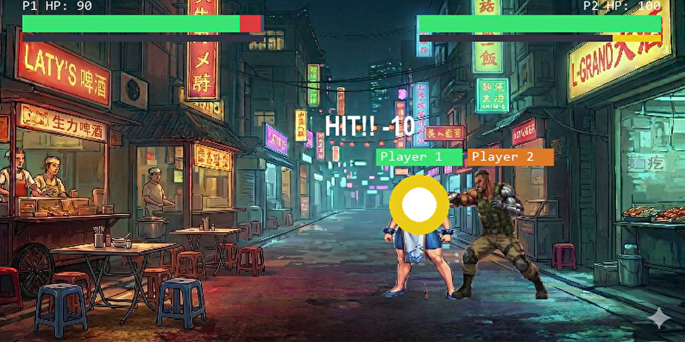
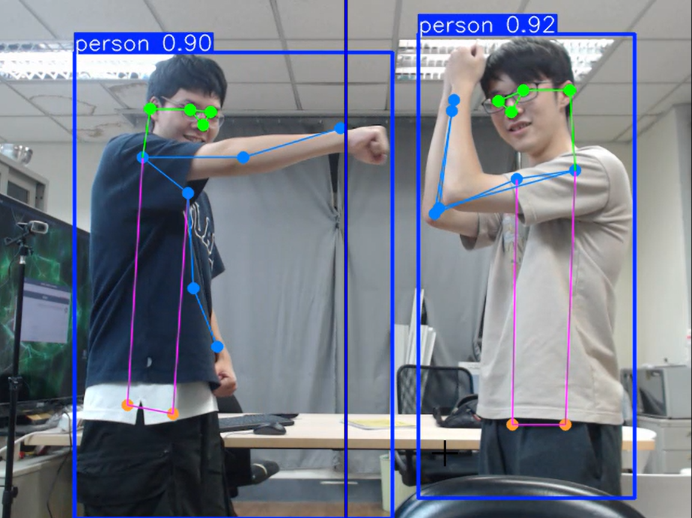

# Pose Fighter

A two-player, pose-controlled fighting game deployed on **NVIDIA Jetson Xavier NX**. It uses **Ultralytics YOLOv8n Pose** with TensorRT for pose estimation and Pygame for gameplay and rendering.



The green bars show health. The thin yellow bars below them show energy, with a maximum of 5 points. Normal hits deal 10 damage and build energy. A fully charged attack deals 20 damage with stronger knockback.

## Player actions and defense



The player on the left attacks while the player on the right raises both hands to defend. The corresponding game screenshot shows player 2 blocking the attack and player 1, the attacker, receiving the `STUNNED!` status.


A successful block prevents damage, cancels the attack, and stuns the attacker for 30 gameplay update frames. The pose overlay above is a demonstration capture. The current game displays the Pygame window without a separate pose preview.

## Controls and rules

Stand on opposite halves of the mirrored camera view, keeping shoulders, wrists, and hips visible.

| Action | Player movement | Game response |
| --- | --- | --- |
| Player assignment | Stand on the left or right half of the mirrored view | Control player 1 or player 2 |
| Attack | Extend an arm toward the opponent, then retract it | Trigger one punch on retraction, with damage applied within attack range |
| Defend | Raise both wrists to shoulder height or above | Block attacks and stun the attacker |
| Move forward or backward | Lean toward or away from the opponent | Move the character in that direction |
| Exit | Close the game window | Quit the game |

Each player starts with 100 HP. Normal hits build energy, and the third hit in a combo grants an additional energy point. A hit with full energy consumes the charge and triggers a critical attack. When a player's HP reaches zero, the game displays the winner and automatically resets after a short delay.

### Critical hits


Critical hits display `CRITICAL BREAK!! -20` with a larger red impact effect and stronger knockback. Knocking an opponent into a wall also causes a bounce and stun. Other effects include hitstop, screen shake, combo counters, and trailing health bars.

## Architecture

```text
Camera
  |
  v
Background thread: YOLOv8 Pose / TensorRT -> keypoints -> action detection
  |
  v
Queue: latest result only
  |
  v
Main thread: Pygame -> movement and hit detection -> health, effects, rendering
```

- Pose estimation and gameplay run in separate threads, with rendering targeting 60 FPS.
- Players are assigned by the camera midpoint and should remain on their own side.
- Punches trigger when the arm retracts. The punch animation lasts 15 frames to reduce flicker.
- Characters remain visible when pose detection is lost, with movement and defense returning to idle.

## Setup

| Component | Configuration |
| --- | --- |
| Deployment hardware | NVIDIA Jetson Xavier NX |
| Docker base image | `nvcr.io/nvidia/l4t-pytorch:r35.2.1-pth2.0-py3` |
| Pose model | Ultralytics YOLOv8n Pose, version `8.2.100` |
| Camera | USB camera at `/dev/video0`, configured for 640 x 480 |
| Game window | 800 x 400, displayed through X11 |

Use a Jetson desktop session with Docker and NVIDIA Container Runtime installed. The exact host JetPack, CUDA, and TensorRT versions used for the original deployment were not recorded.

From the repository root, run the following commands on the Jetson.

```bash
cd game
sudo docker build -t pose-fighter:v1 .
bash run.sh
```

Run these commands inside `game/`, where the model and assets are resolved relative to the working directory. The launch script mounts that directory at `/app` and enables the NVIDIA runtime, X11 display, and USB camera access.

Dependencies are managed by `game/Dockerfile`. It uses NVIDIA's L4T PyTorch image, installs Ultralytics `8.2.100` and Pygame, and preserves the Jetson OpenCV installation. Compatible TensorRT and OpenCV packages must be available in the container environment. The script includes a CSI camera fallback, which requires GStreamer and additional container configuration.

## Model files

`main.py` loads the TensorRT engine through Ultralytics.

```python
MODEL_PATH = 'yolov8n-pose.engine'
model = YOLO(MODEL_PATH)
```

| File | Purpose |
| --- | --- |
| `game/yolov8n-pose.onnx` | Model graph and weights in ONNX format, usable by compatible runtimes and TensorRT's engine builder |
| `game/yolov8n-pose.engine` | Optimized TensorRT engine loaded by the game |

TensorRT engines depend on GPU and software compatibility. Rebuild the engine in the target environment when necessary. The included engine metadata records Ultralytics `8.2.100`, a 640 x 640 input, and 17 keypoints. Its FP32, FP16, or INT8 precision has not been verified. [ONNX documentation](https://onnx.ai/onnx/intro/concepts.html), [TensorRT documentation](https://docs.nvidia.com/deeplearning/tensorrt/latest/inference-library/python-api-docs.html)

## Quantization experiment


The historical screenshots label the models as FP32 and INT8, with the game frame rate showing approximately 61 FPS in both captures. `FPS` measures the Pygame frame rate. `Inf` measures the model call, including preprocessing and postprocessing.

The timing values overlap with the HP text, so no exact speedup is reported here. The original calibration images and complete measurements were not retained, which limits reproducibility of the experiment.

### INT8 calibration reference

The reference script uses TensorRT Entropy Calibrator to calibrate and build an INT8 engine. It is provided as the original experimental implementation. [Calibration script](scripts/build_int8_engine.py)

Before running it, prepare the following inputs and environment.

- Place your ONNX model at `scripts/best.onnx`, or edit the input path in the script.
- Put `.jpg` or `.png` calibration images in `scripts/calib_images/`. Use representative human poses, lighting, backgrounds, and camera distances from the deployment environment.
- Install compatible TensorRT, PyCUDA, OpenCV, and NumPy packages. The game Dockerfile does not install PyCUDA.
- Match the batch size, input shape, and preprocessing to your ONNX model. The defaults are batches of 4 and a 640 x 640 input, with direct resizing, RGB/CHW conversion, and normalization to `[0, 1]`. At least one full batch is required.

From the repository root, run the script in the prepared calibration environment.

```bash
cd scripts
python3 build_int8_engine.py
```

It writes `yolo_int8.engine` and `yolo_calib.cache`. Calibration inputs and generated files are excluded by `.gitignore`. Evaluate accuracy and performance again when using new calibration data. Compatibility with other ONNX models and TensorRT versions requires validation.

## Repository layout

```text
.
├── README.md
├── .gitignore
├── game/
│   ├── .dockerignore
│   ├── Dockerfile
│   ├── main.py
│   ├── run.sh
│   ├── background.png
│   ├── player1_idle.png / player1_punch.png / player1_defend.png
│   ├── player2_idle.png / player2_punch.png / player2_defend.png
│   ├── yolov8n-pose.engine
│   └── yolov8n-pose.onnx
├── scripts/
│   └── build_int8_engine.py
└── docs/
    └── images/
        ├── attack_hit.png
        ├── player_actions.png
        ├── defense_success.png
        ├── critical_hit.png
        └── quantization_comparison.png
```

## Assets and credits

All game backgrounds and character images were generated with **Google Gemini**. The team implemented pose-based action detection, two-player game rules, Pygame rendering, and Jetson Xavier NX deployment.

- Human pose estimation uses Ultralytics YOLOv8n Pose. The included engine metadata identifies its license as AGPL-3.0. Refer to the upstream project for software and model licensing. [Ultralytics YOLO](https://github.com/ultralytics/ultralytics)
- Game rendering, input events, and collision detection use Pygame. [Pygame](https://www.pygame.org/)
- GPU inference uses NVIDIA TensorRT. [TensorRT](https://developer.nvidia.com/tensorrt)
